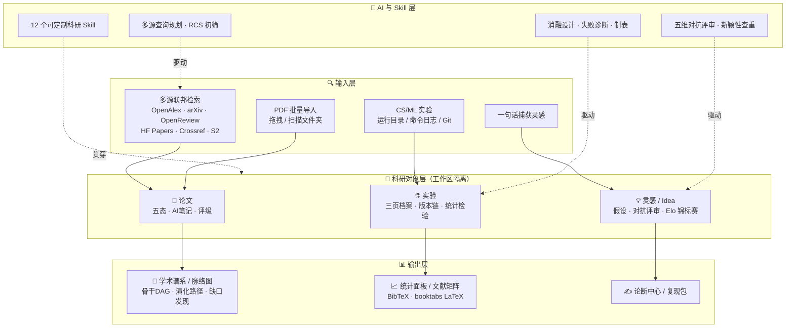

<div align="center">

# 🧠 科研台 · ResearchDesk

**一个本地优先的「科研认知外骨骼」—— 把读什么、想什么、做什么，从散乱文件变成结构化、可关联、可复现的活系统。**

[](https://www.electronjs.org/)
[](#-快速开始)
[](#-数据存储)
[](#-ai-科研-skill-体系重要卖点)
[](LICENSE)

论文 · 灵感 · 实验 · 检索 · 谱系　｜　五大板块一体　｜　AI 科研 Skill 体系　｜　数据全部本地

</div>

---

## ✨ 为什么做这个

好的科研台不是一套软件，而是**认知外骨骼**。它应该：

- ⚡ **降低启动摩擦** —— 坐下来就能接上昨天的思路
- 🔗 **作为慢思考的容器** —— 用链接与时间线让零散念头产生偶然关联
- 📦 **把隐性经验变成可复现资产** —— 假设、失败、决策依据都留痕
- 🛡️ **保护注意力** —— 作为过滤界面，训练"什么值得关注"的科研直觉
- 🔄 **重塑研究习惯** —— 逼你记录"为什么放弃某条路"，就会更擅长复盘

整个工作台的每条设计，都以服务这五条为准则。

---

## 🚀 快速开始

```bash
# 安装依赖
npm install

# 启动应用
npm start
```

首次启动会自动从 `app-data/` 生成干净的 `data/` 目录（一个空工作区）。应用**离线可用**，只有 AI 功能和论文检索需要联网。

> 💡 **环境提示**：若从某些开发终端启动时 `ELECTRON_RUN_AS_NODE=1` 导致以 node 模式运行，先执行 `unset ELECTRON_RUN_AS_NODE NODE_OPTIONS` 再 `npm start`。
>
> 📦 **想要免环境版本？** 运行 `npm run package` 可产出 Windows x64 便携版 zip：解压双击 `科研台.exe` 即用，数据写在 exe 同级 `data/`，拷到 U 盘数据跟着走。

---

## 🗺️ 功能全景



---

## 📚 五大板块

### 🔍 一、多源前沿检索
> 描述一句研究问题，跨六个学术库并行找论文。

- **六源联邦检索**：OpenAlex（引用关系）· arXiv（最新预印本）· OpenReview（顶会录用核验、过滤拒稿）· HF Papers（社区热度/代码）· Crossref（DOI 载体）· Semantic Scholar（影响力/TLDR），可勾选启用，失败源自动降级
- **Skill 驱动查询规划**：自然语言自动拆成 2–3 条互补英文检索式 + 标准布尔式，跨源并行（arXiv 串行错峰防限流）
- **跨源去重融合**：按 arXiv ID / DOI / 标题融合，正式发表覆盖 arXiv 镜像，过滤拒稿撤稿；标注前沿综合分、引用增速、多源共识、开源 Stars
- **申明式筛选**：年份 / 最低引用 / 仅正式发表 / 仅含代码 / 仅开放 PDF / 结合本地库上下文 / AI 相关性初筛（RCS 0–10）
- **今日前沿雷达**（HF Daily Papers）、**单篇引文滚雪球**（前向追踪 + 后向溯源）
- **结果 S/A/B/C 自动评级** + 五维明细、多维度重排、**BibTeX / 综述矩阵导出**、勾选批量入库（自动提炼摘要、可选下载开放 PDF）

### 📄 二、论文
- PDF 批量导入 / 文件夹递归扫描 / 拖拽上传；**内嵌 PDF 阅读器**（缩放 50–300%、Ctrl+滚轮、双指捏合、侧栏可拖拽）
- 五态阅读状态 + 必引星标 + 全文搜索；悬停显示浓缩摘要卡
- **AI 四段式笔记 + 浓缩摘要**，读取本地 PDF 正文作证据，标注「AI 生成·请核对原文」并可一键定位 PDF
- **可信度评级**（S/A/B/C + 五维明细）、引用量按需刷新、开放原文一键获取
- `[[双向引用]]` + 反向链接 + 失效引用一键新建；编辑框输入 `/` 弹出本地论文引用选择器

### 💡 三、灵感 / Idea
- 一句话快速捕获；Idea ↔ 待办互转与阶段管理
- **结构化科研假设工作区**：研究问题 / 文献缺口 / 可证伪因果假设 / 方法设计 / 竞争解释 / 成功标准，字段就地编辑
- **五维对抗评审**（新颖性/可行性/清晰度/重要性/文献扎根度）+ **SciMON 跨库新颖性查重**
- **CoI 文献链孵化**、**Idea Elo 成对辩论锦标赛**（K=32，选优 + 杂交进化）
- **HypoRefine**：实验结论自动回流修订假设；Idea 一键无损转实验
- **论断中心**：聚合支持 / 反驳 / 待检验证据网络

### ⚗️ 四、实验（CS/ML 工程闭环）
- 设计 / 参数 / 结果三页档案，全部字段就地编辑；`basedOn` 版本链与演进树
- **零手工 CS 实验导入**：扫描 Hydra / HuggingFace / W&B / Lightning / TensorBoard / log 运行目录，或粘贴命令/终端日志自动解析超参与指标（检测 OOM/NaN）
- **CS 工程运行锚点**：绑定启动命令、代码仓、Git Commit / Diff、Checkpoint，一键复制命令
- **超参 Sweep 生成器**：网格脚本（并行 Bash / tmux / Slurm Array / Hydra -m）
- **AI 消融设计 + 结果诊断复盘**（Keep/Discard/Blocked 裁决、根因修复、下一版补丁）
- **纯 JS 统计分析**：多种子 Mean±Std、rliable IQM、95% CI、Welch t-test / Mann-Whitney U / Cohen's d
- **CSV/TSV/JSON/LOG/TensorBoard 内嵌图表**（EMA 平滑、双轴、PNG 导出）、实验总榜、顶会 **booktabs LaTeX 制表**、负结果台账、可复现实验包

### 🔗 五、学术谱系 / 论文脉络
> 把"一脉相承"从脑子里的模糊印象，变成可导航的证据链。

- 本地 + 检索论文的引用图，**三种布局**：骨干 DAG（拓扑分层、剪枝噪音）/ 关系网络 / 时间轴；缩放平移、多维筛选
- **5 类关系**：直接引用 / 笔记显式引用 / 共引 / 共同被引 / 共同作者
- **最短演化路径**（选起终点找演进链）、**谁引用它**（联网动态加入引文边）
- **缺失关键文献发现**（Top Cited 奠基 / Top Citing 前沿）、元数据与引文一键补全
- **AI 谱系综述**：学术演进叙事 + 研究缺口（一键送 Idea 孵化）+ 渐进精读队列 + 引用校验
- **六列文献对比矩阵**（任务/方法/假设/数据/指标/局限），一键复制 Markdown

---

## 🤖 AI 科研 Skill 体系（重要卖点）

把开源 Agent/Skill 项目的科研方法论**内嵌为可执行技能**，覆盖检索 / Idea / 实验 / 谱系 / 论文五大领域。每个 skill 支持查看规范、选用、**从 GitHub 仓库或本地 SKILL.md 导入**、删除自定义 skill；检索 skill 会真实驱动数据源路由与查询规划，而非只是文案模板。

| 类别 | Skill | 用途 |
|---|---|---|
| 🔍 检索 | **Paper Search Pro** | 多源系统检索：拆检索式、并行检索、跨源去重、载体修正 |
| 🔍 检索 | **Frontier SOTA Radar** | 按引用增速 + 开源热度发现最新带代码的 SOTA |
| 🔍 检索 | **Citation Snowball** | 引文滚雪球：前向追踪 + 后向溯源 |
| 🔍 检索 | **Systematic Review** | PRISMA-S/PICO 布尔式、查重、BibTeX 与综述矩阵 |
| 💡 Idea | **Chain-of-Ideas** | 文献链渐进式孵化可证伪、带锚点的 Idea |
| 💡 Idea | **Hypothesis Critique & SciMON** | 五维对抗评审 + 新颖性冲突时差异化转向 |
| 💡 Idea | **Co-Scientist Tournament** | Elo 锦标赛选优、杂交进化、假设回流 |
| ⚗️ 实验 | **Experimental Design & Ablation** | H1/H0、三类变量、混杂审计、消融矩阵 |
| ⚗️ 实验 | **Statistical Analysis & Failure Diagnosis** | 统计检验 + 日志扫描诊断 + 负结果台账 |
| ⚗️ 实验 | **CS/ML Experiment Engineering** | 命令日志接入 → Git Diff → Sweep → IQM → booktabs |
| 🔗 谱系 | **Research Genealogy** | 学术谱系骨干 DAG 与严格证据约束的缺口 |
| 🔗 谱系 | **Five-Lens Synthesis** | 五透镜综述、六列矩阵、引用校验 |
| 📄 论文 | **论文阅读方法 / 可信度评级 v1.1** | 四段式证据精读 / SABC 评级防误判规则 |

> 🎯 关键能力均带**离线降级**：无 API Key 时走确定性规则与结构化引擎，UI 明确标注"离线规范评估 / 确定性诊断引擎"，保证无网也能工作。

---

## 🎛️ 全局体验

- 🪟 **无边框窗口** + 自绘顶栏；**5 大板块** `Alt+1..5` 切换
- 🌗 **双主题**：简约（浅色学术）/ 炫酷（深色霓虹玻璃），切换即时重绘所有图表
- ⌨️ 命令面板 `Ctrl+K`（跳转工作区/条目/命令）、快捷键帮助 `Ctrl+/`、列表键盘导航
- 🎯 专注模式（`Esc` 退出）、多处分栏可拖拽并记忆、悬浮摘要卡
- 📊 **工作区统计面板**：五态分布 / 增长趋势 / 实验时间线 / 状态占比
- 🔧 统一 SVG 图标系统、Toast 通知、模态焦点陷阱、无障碍属性
- 📸 无头截图验证：`node start.js --shot[=路径] [--shot-action=cmdk|help|stats|timeline|discovery|...]`

<details>
<summary><b>⌨️ 全部快捷键</b></summary>

| 快捷键 | 功能 |
|---|---|
| `Ctrl + K` | 命令面板：跳转工作区 / 条目 / 命令 |
| `Ctrl + F` | 聚焦当前板块搜索框 |
| `Ctrl + N` | 在当前板块新建条目 |
| `Ctrl + /` | 快捷键帮助 |
| `Alt + 1 / 2 / 3 / 4 / 5` | 切换 检索 / 论文 / 脉络 / Idea / 实验 |
| `↑ / ↓` · `Enter` | 列表导航 · 打开条目 |
| `Esc` | 关闭弹窗 / 退出专注模式 |
| `Shift + F10` | 唤出右键菜单 |
| `Shift + Enter` | 检索框换行 |
| `Ctrl + Enter` | 多行字段就地保存 |

</details>

---

## 💾 数据存储

**一实体一 Markdown + YAML frontmatter**，可用 Obsidian 等工具直接打开；附件（PDF / 图表 / 数据）存工作区子目录，md 用相对路径引用。工作区之间完全隔离。

```
.
├── main.js / preload.js / start.js   # Electron 主进程 / IPC 桥 / 启动器
├── src/
│   ├── main/
│   │   ├── store.js                 # 数据层：工作区/实体/PDF/引用图/数据外置
│   │   ├── ai.js / openalex.js / rating.js
│   │   ├── search/                  # 六源连接器 / 融合 / Skill 规划
│   │   ├── services/                # 实验 / Idea / 谱系 / PDF 抽取 / CS 导入
│   │   └── skills/                  # 内置科研 Skill（md）
│   └── renderer/                    # 原生 JS 界面（无框架）
│       ├── controllers/             # 检索/论文/Idea/实验/引用/工作区/浮层
│       ├── app.js / stats.js / timeline.js / charts.js / icons.js
│       └── index.html / styles.css + css/
├── app-data/                        # 干净首次启动骨架（默认配置 + 评级 skill）
└── data/                            # 运行时生成（.gitignore 已忽略，含个人隐私）
```

**IPC 安全白名单**：渲染层只能调用白名单内服务方法，文件对话框、系统打开、窗口控制均经主进程。

---

## ⚙️ 配置

启动后进入 **设置**：

1. 填写 OpenAI 兼容的 API 地址 / 密钥 / 模型（如 DeepSeek：`https://api.deepseek.com/v1` · `deepseek-chat`），可点「测试连接」
2. 密钥明文存于本地 `data/app-config.json`（**已加入 `.gitignore`，请勿提交**）
3. 可选：Semantic Scholar Key、OpenAlex personal Key（提额）、默认检索条数
4. 可从笔记样本学习个人写作风格并固化为 skill，或导入外部 SKILL.md

---

## 🙏 致谢与来源

内置科研 Skill 的方法论参考了多个开源项目与公开方法论（检索 / ELN / 可复现研究 / Idea 管理），并在 `app-data/skills` 与 `src/main/skills` 中保留了规范文本。评级 skill 经真实 LLM 校准（一致率 5/10 → 9/10）。所有 AI 生成内容均标注来源，**仅作辅助判断、非学术定论**。

---

## 📄 许可

本项目采用 [MIT License](LICENSE) —— 你可以自由使用、修改、分发，包括商用，只需保留版权声明。

## ⚠️ 说明

- 本项目定位是**个人科研助手**：本地优先、零配置、低认知负荷；不支持多人协作、云同步或服务端。
- API 密钥以明文存于本地，已加入 `.gitignore`，请妥善保管、切勿外传或误提交。
- AI 摘要 / 笔记 / 评级 / 诊断均需核对原文，不把 AI 输出伪装成事实。

<div align="center">

**Made for researchers who think in links, not folders.**

</div>
